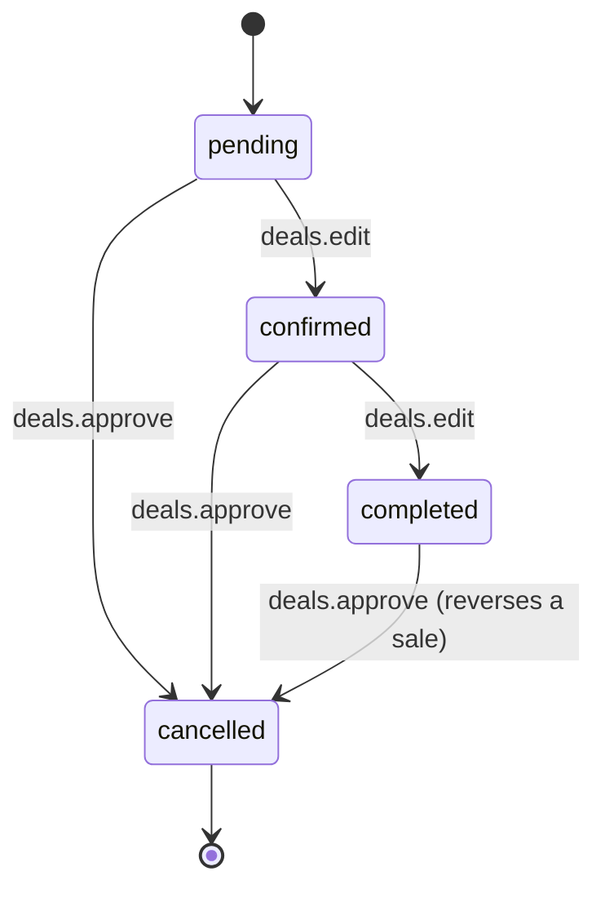
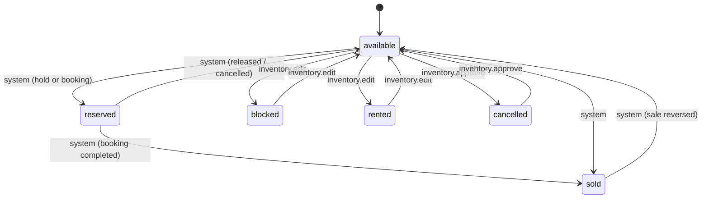
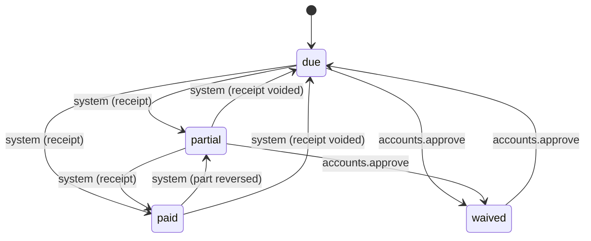
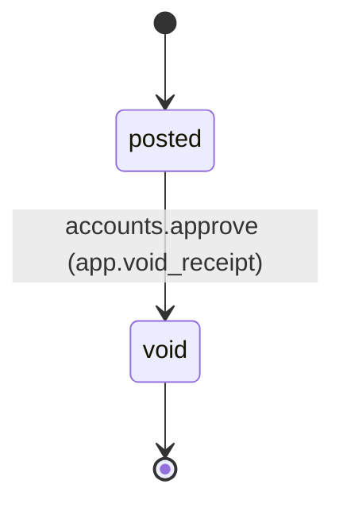
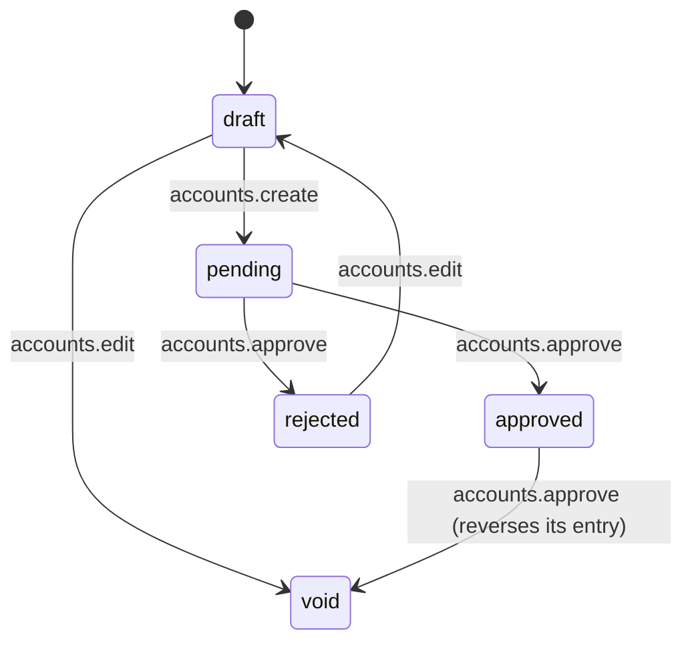

# PropIQ — State machines

The database enforces every status change below (table `state_transitions`, trigger `app.enforce_transition`). The API reads the same table (`app.allowed_transitions(entity, from)`) to decide which buttons to show, so a screen can never offer a move the database will refuse.

- **Permission** is `module.action` as in `lib/permissions.ts`. The API sets `app.permissions` for each request; a transition whose permission is missing is refused (`42501`). "system" means the move is made by other records (a receipt, a hold, a booking), never directly by a user.
- To change a rule, edit the seed rows in `docs/schema/core.sql` **and** this file, and add a test in `docs/schema/smoke-test.mjs`.
- Cheques, quotations and the deal (sauda) are not in the executable schema yet; their machines are specified when those tables are built (Wave 2 / P3.7).

## Booking

A live booking (pending, confirmed, completed) reserves the property; only one live booking per property can exist.

Payment-plan rules for installment bookings (cash bookings have none):
- **Confirm** needs a schedule that adds up exactly to the net price (`app.build_schedule` makes one; the rounding remainder goes into the last installment).
- **Complete** needs every installment paid or waived.
- After confirmation the total is locked: amounts, price or discount may change only if the schedule still adds up by the end of the transaction (a reschedule is allowed, a silent change is not).

## Property

`reserved` and `sold` are never typed in; they follow from holds and bookings. A property with a live hold or booking cannot be blocked, rented or cancelled.

## Installment

Paid amount and status are recomputed from the receipt allocations; nobody edits them directly.

## Receipt

Voiding reverses every allocation and the journal entry in one transaction. A void receipt cannot be changed.

## Voucher

Maker-checker: the person who submits and the person who approves are different permissions.
